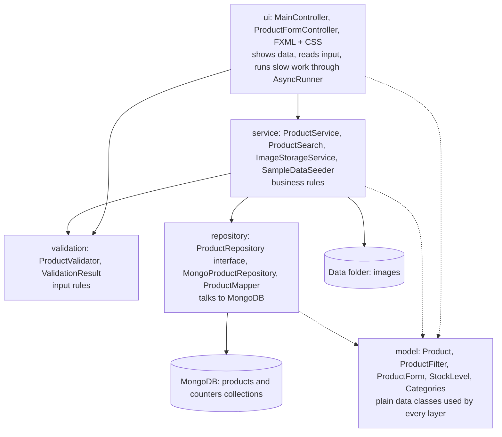

# 3. Design notes

1. [Architecture](#1-architecture)
2. [Class responsibilities](#2-class-responsibilities)
3. [MongoDB schema](#3-mongodb-schema)
4. [Search and filtering design](#4-search-and-filtering-design)
5. [Image storage](#5-image-storage)
6. [Integration points for the other components](#6-integration-points-for-the-other-components)
7. [Stock and the future Inventory component](#7-stock-and-the-future-inventory-component)
8. [Threading model](#8-threading-model)
9. [Error handling](#9-error-handling)
10. [Design decisions and alternatives](#10-design-decisions-and-alternatives)
11. [Future work ideas](#11-future-work-ideas)

---

## 1. Architecture

The code is split into layers. A layer only talks to the layer directly below it, so each part can be explained, tested and changed on its own.



* **`AppContext`** wires everything: it reads `AppConfig`, opens the MongoDB connection (`connect()`), and hands out the `ProductService` and `ImageStorageService`.
* The UI never imports a MongoDB class. The service never imports a JavaFX class. That is why the validator, search, service and seeder are unit-tested with no database and no window.
* `ProductRepository` is an interface. `MongoProductRepository` is the real one. The tests use `InMemoryProductRepository` (in `src/test` only). The running application always uses MongoDB.

## 2. Class responsibilities

| Package | Class | Responsibility |
|---|---|---|
| (root) | `Launcher` | `main` method that starts JavaFX (needed so Eclipse/Maven can launch a JavaFX app from the classpath) |
| | `MainApp` | JavaFX `Application`: loads `main-view.fxml`, passes it the `AppContext`, closes things on exit |
| | `SeedMain` | The explicit seed command (`mvn compile exec:java@seed`) |
| | `AppContext` | Builds the MongoDB connection, repository and services; `connect()` throws `DatabaseException` if MongoDB is down |
| `config` | `AppConfig` | Reads settings: environment variable, then `config/application.properties`, then defaults; hides passwords when a URI is displayed |
| `model` | `Product` | One product. `id` is `final` (no setter) so it can never change. `price` is `BigDecimal` |
| | `ProductForm` | Raw text typed in the form (a record). Validated before it becomes a `Product` |
| | `ProductFilter` | The search/filter settings (name, category, min/max price, availability, status) |
| | `StockLevel` | `OUT_OF_STOCK` / `LOW_STOCK` (1 to 5) / `IN_STOCK`; drives the coloured badges |
| | `Categories` | Default category names (an array), trimming, duplicate removal |
| `validation` | `ProductValidator` | One method per rule; returns an error message or `null` |
| | `ValidationResult` | Map of field name to message; `ValidationException` carries it |
| `repository` | `ProductRepository` | Interface: `nextProductId`, `insert`, `update`, `deleteById`, `findById`, `findAll` |
| | `MongoProductRepository` | MongoDB implementation; creates indexes; turns driver errors into `DatabaseException` |
| | `ProductMapper` | `Product` to MongoDB `Document` and back (`Decimal128` for money) |
| `service` | `ProductService` | Add, edit, activate/deactivate, delete, search. Validates again before saving |
| | `ProductSearch` | The filtering loops and conditions (pure Java) |
| | `ImageStorageService` | Validates and copies images, resolves and deletes them |
| | `SampleDataSeeder`, `PlaceholderImageGenerator` | Sample data and locally drawn pictures |
| `ui` | `MainController` | Table, filters, details panel, status messages |
| | `ProductFormController` | The add/edit dialogue, image import, field-level errors |
| | `AsyncRunner` | Runs work on a background thread and returns results to the JavaFX thread |
| | `ProductImageLoader`, `Formatters`, `Dialogs` | Image nodes with fallbacks, £ and date formatting, confirmation dialogue |

## 3. MongoDB schema

MongoDB is schema-less, but the application writes (and expects) this shape. Database: `marketplace` (configurable). Collection: **`products`**.

### 3.1 Fields of a `products` document

| Field | BSON type | Required | Meaning / rule |
|---|---|---|---|
| `_id` | String | yes | **The product ID**, e.g. `PRD-00007`. Unique (MongoDB guarantees `_id` uniqueness) and immutable (MongoDB refuses to change `_id`). This is the value other components reference. |
| `name` | String | yes | Not blank, at most 100 characters (trimmed) |
| `description` | String | yes (may be empty) | At most 1000 characters |
| `price` | **Decimal128** | yes | Greater than 0, at most 2 decimal places, at most 9 digits before the point. Read back as `BigDecimal` |
| `stockQuantity` | Int32 | yes | Whole number 0 or more |
| `active` | Boolean | yes | `true` = shown and for sale, `false` = deactivated (kept for history) |
| `categories` | Array of String | yes | One or more labels, e.g. `["Electronics","Audio"]`. Each at most 30 characters, no duplicates ignoring case |
| `imagePaths` | Array of String | yes (may be empty) | Relative references, e.g. `["images/5edab609-....png"]`. At most 6 |
| `createdAt` | Date (UTC) | yes | Set once when the product is created, never changed |
| `updatedAt` | Date (UTC) | yes | Changed on every edit / activate / deactivate |

Example (this is what `mongosh` printed for a seeded product):

```js
{
  _id: 'PRD-00001',
  name: 'Wireless Noise-Cancelling Headphones',
  description: 'Over-ear Bluetooth headphones with 30-hour battery life and active noise cancelling.',
  price: Decimal128('129.99'),
  stockQuantity: 24,
  active: true,
  categories: [ 'Electronics', 'Audio' ],
  imagePaths: [ 'images/5edab609-5182-4f0e-887b-53f08aa97db6.png', 'images/d07788ae-7623-451a-82b0-54f2de7a320c.png' ],
  createdAt: ISODate('2026-10-30T16:05:40.293Z'),
  updatedAt: ISODate('2026-10-30T16:05:40.293Z')
}
```

### 3.2 Why these choices

* **Decimal128 for price.** `double` cannot store 0.10 exactly (0.1 + 0.2 = 0.30000000000000004). `Decimal128` stores decimal digits exactly and maps to Java `BigDecimal`. No money value ever passes through `double` in this code (`ProductMapperTest` and `ProductValidatorTest.toPriceAlwaysGivesTwoDecimalPlacesWithoutFloatingPointError` prove it).
* **Product ID as `_id`.** One field does both jobs (database key and business ID), so there is nothing to keep in sync, and MongoDB enforces uniqueness for free. The ID is a **string** like `PRD-00007`: readable on screen, in orders and in logs.
* **Embedded arrays for categories and images.** A product's categories and pictures belong to that product and are always read with it, so storing them inside the document means one read and no joins. The trade-off is that renaming a category means updating every product that uses it (acceptable here; see future work for a separate `categories` collection).
* **Relative image paths.** See section 5.

### 3.3 ID generation: the `counters` collection

IDs come from a second collection, **`counters`**, which holds one document: `{ _id: "products", seq: 15 }`.
`MongoProductRepository.nextProductId()` runs one atomic MongoDB command (`findOneAndUpdate` with `$inc: {seq: 1}`, `upsert: true`, returning the **new** document) and formats the number as `PRD-` + 5 digits.
Because MongoDB performs the increment atomically, two users (or two components) can never be given the same number; `MongoProductRepositoryIT` proves it with 40 requests from 8 threads.
Numbers are **never reused**: after a product is deleted its number stays retired, so an old order can never accidentally point to a different, newer product.
A rejected form does not consume a number, because `ProductService.addProduct` validates before asking for the ID.

### 3.4 Indexes

Created at start-up by `MongoProductRepository.ensureIndexes()` (safe to repeat).

| Index | Created by | Purpose |
|---|---|---|
| `_id_` (unique, automatic) | MongoDB | Lookup by product ID (`findById`, edit, delete, and every other component's lookups) |
| `name_1` | `ensureIndexes` | Name lookups and sorting |
| `categories_1` (multikey) | `ensureIndexes` | "All products in category X" |
| `price_1` | `ensureIndexes` | Price-range queries |

Note: the application currently loads the whole collection and filters in Java (section 4), so only `_id_` is exercised today.
The other three are cheap to keep and are the ones a MongoDB query would use once search moves into the database, or when another component queries `products` directly by category or price.

## 4. Search and filtering design

`ProductService.search(filter)`: `repository.findAll()`, then `ProductSearch.filter(all, filter)`, sort by name, and wrap in a `SearchResult` (matches, total count, stock-level counts, categories).

* **Combined filters** use AND: `ProductSearch.matches` runs five checks (`matchesName`, `matchesCategory`, `matchesPrice`, `matchesAvailability`, `matchesStatus`) and returns `false` at the first one that fails.
* **Name search** is a case-insensitive "contains" on the trimmed text; blank text matches everything.
* **Price range** is inclusive and uses `BigDecimal.compareTo` (never `equals`, which treats `10.0` and `10.00` as different).
* **Availability** is stock-based (In stock = stock above 0, Out of stock = 0). **Status** is Active/Inactive. They are separate drop-downs so they can be combined (e.g. "active products that are out of stock").
* **Why in Java, not in MongoDB queries?** It is easy to unit-test without a database, simple to explain in a viva (loops and conditions), and fast for a catalogue of hundreds to a few thousand products. The cost is that every search reads all products. If the catalogue grew large, build a `Bson` filter from `ProductFilter` in `MongoProductRepository` (the indexes exist for that) and keep `ProductSearch` only for tests.
* The UI waits 300 ms after typing stops, ignores results of searches that have already been overtaken by a newer one (`searchTicket`), and validates the price boxes first (`ProductValidator.validatePriceRange`).

## 5. Image storage

| Item | Detail |
|---|---|
| Where | `<data dir>/images/`. The data dir is `data` by default (setting `PRODUCTS_DATA_DIR` / `data.dir`). Created on first upload. |
| File name | A random UUID plus the real extension: `3f2a9c1e-....png`. Original file names are never used (no clashes, no odd characters, nothing to leak). |
| Reference stored in MongoDB | `images/<uuid>.<ext>`: **relative, always forward slashes.** The absolute location is computed at run time (`ImageStorageService.resolve`). Move the whole data folder to another computer, or Windows to macOS, and every reference still works. |
| Accepted | PNG, JPG/JPEG, GIF, BMP. Extension must be one of `ALLOWED_EXTENSIONS` **and** the first bytes of the file must match a real image signature (`detectFormat`), so a renamed `.txt` is rejected. The stored extension follows the real content. |
| Size | 1 byte to 5 MB (`MAX_FILE_SIZE_BYTES`). Empty and oversized files are rejected. At most 6 images per product. |
| Safety | `resolve` normalises the path and refuses anything outside the data folder (`../x`, absolute paths). |
| Not checked | The file is not fully decoded, so a file with a valid header but corrupt body is accepted. It will show **"Image unavailable"** instead of crashing (JavaFX reports `image.isError()`), and the user can remove it. |
| Missing / broken files | `ProductImageLoader` shows a grey "No image" (product has none) or "Image unavailable" (file missing/unreadable) box. Nothing throws. |
| Off the UI thread | Validation + copying run in `AsyncRunner`. Showing images uses JavaFX `backgroundLoading`, so the UI thread never reads image files. |

**Life cycle of an image file** (so no orphan files are left behind):

| Event | What happens to the file |
|---|---|
| User picks a file in the form | Validated and copied immediately (background thread); it appears as a thumbnail. Remembered in `newlyAddedRefs`. |
| User clicks **X** on a thumbnail added in this session | Removed from the form and the file deleted at once. |
| User clicks **X** on a thumbnail of an already-saved product | Removed from the form only; the file is deleted by `ProductService.updateProduct` **after** the save succeeds (so Cancel loses nothing). |
| User clicks **Cancel** or closes the window | `discardNewImages()` deletes every file copied during this dialogue. |
| Product saved | `newlyAddedRefs` cleared: the files now belong to the product. |
| Product deleted | `ProductService.deleteProduct` deletes all its files after the database delete succeeds. |

## 6. Integration points for the other components

This component implements **only Products**. Below is what other components can rely on. The shared names and ID formats are agreed with the other component owners and recorded in `docs/SHARED-CONVENTIONS.md` at the repository root.

### 6.1 The shared key

Every other component should store the product's ID as a **string field**, ideally named `productId` (the brief says variable names shared between components should be identical), holding exactly the `_id` value, e.g. `"PRD-00007"`.

| Component | What it would reference | Suggestion for the owner of that component |
|---|---|---|
| **Orders** | `productId` on each order line | Also copy the product's **name and unit price into the order line** at the time of purchase (a "snapshot"), so changing a price later does not rewrite old orders. Before accepting a line, check the product exists and `isActive()`. |
| **Reviews & Ratings** | `productId` on each review | Group by `productId` to compute average ratings. |
| **Inventory / Warehousing** | `productId` on each stock record | See section 7. |
| **Finance & Reporting** | `productId` via orders | Product `name` and `categories` for "sales by category". |

### 6.2 Ways to read products

1. **Same Java application (most likely for the final merged system):** call `ProductService`, obtained from the shared `AppContext`:
   * `getById(String productId)`: one product, throws `ProductNotFoundException` if it does not exist
   * `getAllProducts()`: everything
   * `search(ProductFilter filter)`: filtered, sorted, with counts
   * (Product has `isActive()`, `isAvailableForSale()`, `getPrice()`, `getStockQuantity()`, `getCategories()`)
2. **Reading MongoDB directly:** use the `products` collection and the field table in section 3.1 as the contract. Read `price` as `Decimal128` to `BigDecimal`.

Methods **not** implemented (they belong to the integration work with the other components): changing stock from an order (for example an atomic `adjustStock(productId, delta)`), or listing only sellable products. `isAvailableForSale()` already encodes the rule "active and stock above 0".

### 6.3 Deleting versus deactivating

Deleting a product leaves any order or review that mentions it pointing at nothing. **Prefer Deactivate** for products that have ever been sold; the UI's delete confirmation says so. When Orders exist, the group should decide one rule (for example "a product that appears in any order may not be deleted") and implement the check in `ProductService.deleteProduct`.

### 6.4 One database, several collections

All components can share the same MongoDB database (default `marketplace`) with one collection each (`products`, `orders`, `customers`, ...). Use the same `MONGODB_URI` / `MONGODB_DATABASE` settings. Only `products` and `counters` (document `_id: "products"`) belong to this component.

## 7. Stock and the future Inventory component

The brief keeps a **stock quantity on the product** (this component: `Product.stockQuantity`, validated as a non-negative integer) while the Inventory component keeps stock **per warehouse**. Possible ways to connect them later:

| Option | How | Pros / cons |
|---|---|---|
| **A. Products owns the number** (what exists now) | Orders and Inventory read `stockQuantity` and ask Products to change it | Simplest; but Inventory's per-warehouse numbers can disagree with it |
| **B. Inventory is the source of truth** | Inventory sums its warehouse quantities per `productId` and writes the total into `Product.stockQuantity` (a new `ProductService` method such as `updateStockQuantity(productId, total)`); the stock box in the form becomes read-only | One truth; needs Inventory to exist first |
| **C. Reconcile** | Keep both and add a report listing products where `stockQuantity` differs from the warehouse total (the brief's optional "highlight discrepancies") | Safe while both are still being built |

When Orders start reducing stock, avoid "read, subtract, write": two orders at once could oversell. Use one atomic MongoDB update that only succeeds if enough stock remains, for example
`updateOne({ _id: id, stockQuantity: { $gte: qty } }, { $inc: { stockQuantity: -qty } })` and treat a result of `matchedCount == 0` as "insufficient stock".
(Described, not implemented, because Orders is not part of this component.)

## 8. Threading model

JavaFX has one **application thread** that draws the window and handles clicks; if it does slow work the window freezes. So:

* All MongoDB calls and all image-file copying run on **one background worker thread** via `AsyncRunner.run(work, onSuccess, onFailure)` (a JavaFX `Task` underneath).
* `onSuccess` and `onFailure` are called **back on the JavaFX thread**, and only there are controls updated.
* One worker thread means operations run in the order requested (a save cannot overtake an earlier save). Stale search results are discarded using `searchTicket`.
* Pictures are loaded by JavaFX itself in the background (`backgroundLoading = true`).
* `AppContext.isConnected()` and `getProductService()` are deliberately **not** `synchronized`, so the UI thread never waits behind `connect()` (which can take about 3 seconds when MongoDB is down).
* The sequence diagram is in [04-diagrams.md section 9](04-diagrams.md#9-sequence-diagram-which-thread-does-what).

## 9. Error handling

| Situation | Exception | What the user sees |
|---|---|---|
| Invalid form input | `ValidationException` (holds a `ValidationResult`) | Message under each bad field, red outline, focus moves to the first one |
| MongoDB unreachable / timed out | `DatabaseException` ("Cannot reach MongoDB. Make sure MongoDB Community Server is running...") | Red "Database problem" panel with **Retry connection**; the pill next to the title says "Not connected" |
| Wrong MongoDB username/password | `DatabaseException` ("MongoDB rejected the username or password...") | same panel |
| Bad `MONGODB_URI` text | `DatabaseException` ("not a valid MongoDB connection string") | same panel |
| Product removed by someone else meanwhile | `ProductNotFoundException` | Red status-bar message, list reloads |
| Unsupported / oversized / fake image | `ImageStorageException` | Red message under the images in the form, other files in the same selection are still added |
| Missing image file | none | "Image unavailable" box |
| Save fails in the form | any of the above | Red banner above the Save button; the dialogue stays open so nothing typed is lost |

There is **no fallback database**: when MongoDB is down the app says so and waits.

## 10. Design decisions and alternatives

| Decision | Chosen | Alternative and why not |
|---|---|---|
| Product ID | Sequential `PRD-nnnnn` from an atomic counter | `ObjectId`: unreadable in the UI. UUID: no counter, but long and hard to quote in a viva or a test table |
| Filtering | In Java after `findAll()` | MongoDB queries: better at scale, harder to unit-test; see section 4 |
| Categories | Free-text labels embedded in the product | Separate `categories` collection: needed for rename/merge, descriptions, hierarchy: overkill here |
| Delete | Hard delete + Deactivate option | Soft-delete flag only: the brief explicitly lists both delete and deactivate |
| Validation | Static methods returning a message or `null` | Bean Validation annotations: another dependency and less visible code for a viva |
| Repository interface | `ProductRepository` + Mongo implementation | Using the driver directly in the service: couples the rules to MongoDB and makes unit tests need a database |
| Dependencies | JavaFX, MongoDB driver, `slf4j-nop` (silences driver logging), JUnit | Lombok, Spring, Mockito, TestFX: not needed for this size |
| Stage of images | Copied on pick, cleaned on cancel/save | Copy only on save: the preview would have to read the original path, which the brief forbids relying on |

## 11. Future work ideas

Each idea says how it would be done.

1. **Move search into MongoDB queries**: build a `Bson` filter in `MongoProductRepository.search(ProductFilter)` using `Filters.regex`, `Filters.in`, `Filters.gte/lte` with `Decimal128`; the indexes in section 3.4 then pay off.
2. **Separate categories collection** with a management screen (rename, merge, hide).
3. **Optimistic locking** to stop two people overwriting each other: add a `version` field, update with `{_id, version}` and increment; show "this product changed, reload" when `matchedCount == 0`.
4. **Product audit history**: write a `product_history` document on every change (who, when, old and new values).
5. **Bulk actions**: select several rows to activate/deactivate/export; CSV import/export with `Decimal128` handling.
6. **Reorder images / choose the main image** by dragging thumbnails.
7. **Image thumbnails on disk** (a smaller copy generated at upload) to speed up the table for large photos.
8. **Warehouse stock integration** (section 7, options B and C).
9. **Role-based access** once the login component exists (only product managers may delete).
10. **Localised currency** from the user's locale instead of fixed GBP.
